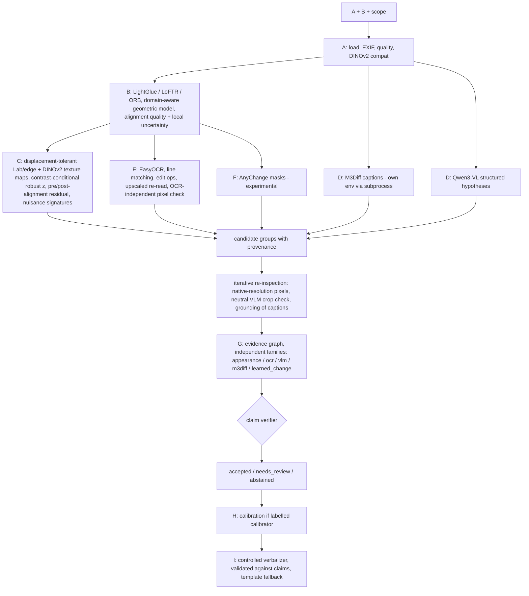

# Evidence-Grounded, Alignment-Aware Fine-Grained Image Difference Understanding

Given two images A and B, the system determines **whether they can be compared**, **what genuinely changed**, **where** (boxes + masks in *both* original images), **before → after state**, **which observations support or contradict each conclusion**, and **when to request review or abstain**. Pretrained models only. Targets a single 16 GB GPU (e.g. RTX A4000).

Research objective: *evidence-grounded, alignment-aware fine-grained image difference understanding with calibrated claim verification.* This is a proposed architecture to be validated empirically. No superiority claims are made.

## Quick start (GPU machine)

```bash
pip install torch==2.6.0 torchvision==0.21.0 --index-url https://download.pytorch.org/whl/cu124
pip install -r requirements-full.txt
python -m pytest tests -q            # no model downloads needed
jupyter lab notebooks/Image_Difference_Pipeline.ipynb
```

Programmatic use:

```python
from idu import make_config, Pipeline
pipe = Pipeline(make_config("full", domain="product"))
result, artifacts = pipe.run("a.jpg", "b.jpg", scope="label text only")   # writes outputs/<run_id>/
print(result["report"]["text"])
```

Presets: `classical` (ORB + low-level evidence, no downloads, CPU-capable) · `ocr` · `semantic` · `full`. Every stage and ablation switch is in [idu/config.py](idu/config.py).

## Fine-grained screenshot evaluation

The executed [DiffSpot upgrade notebook](notebooks/Fine_Grained_Image_Difference_Upgrade_Evaluation.ipynb) evaluates the complete public 4,400-pair web-interface test split. It uses a calibrated same-viewport pixel residual, a conservative review/abstention gate, and appropriate pair/element-box metrics; it does not treat element boxes as pixel masks. The data cache is local and excluded from Git. Results, provenance, and the root-cause assessment are in [reports/fine_grained_upgrade/](reports/fine_grained_upgrade/).

This is a focused screenshot benchmark. It does not establish performance on photographed objects, documents, natural scenes, or remote-sensing images. Keep the domain-specific configuration and evidence checks in the general pipeline for those settings.

## Architecture



Inference order is chosen so that heavy models never share VRAM: validate → align → low-level → OCR → AnyChange → M3Diff (GPU freed, subprocess) → VLM (hypotheses, grounding, crop checks, verbalizer).

| Module | Stage |
|---|---|
| [io_quality.py](idu/io_quality.py) | A: robust loading (EXIF, alpha, hashes), quality (blur, contrast, clipping, JPEG blockiness), pair validation |
| [align.py](idu/align.py) | B: matchers, identity/similarity/affine/homography selection by domain, status `reliable/approximate/unreliable/failed`, local uncertainty, DIS flow |
| [lowlevel.py](idu/lowlevel.py) | C: evidence maps, multiscale hysteresis regions, nuisance signatures, native-resolution re-inspection |
| [ocr.py](idu/ocr.py) | E: OCR, Hungarian line matching in A's frame, char edit ops, re-read, crop pixel verdict |
| [semantic.py](idu/semantic.py) | D: `HFVLMAdapter` (any HF image-text-to-text model), `M3DiffAdapter` (official eval script) |
| [localize.py](idu/localize.py) | F: provenance-preserving merge, AnyChange adapter |
| [evidence.py](idu/evidence.py) | G: observations, evidence graph, decision policy |
| [calibration.py](idu/calibration.py) | H: Platt / isotonic / temperature, ECE, risk-coverage |
| [report.py](idu/report.py) | I: evidence packet, verbalizer + validator, figures, export |
| [evaluate.py](idu/evaluate.py) | synthetic pairs with exact GT, metrics, ablations |
| [pipeline.py](idu/pipeline.py) | orchestration, status board, component self-test |

Every adapter implements `check_environment / load_model / predict / normalize_output / release_resources` ([schema.py](idu/schema.py)).

## Decision policy (Stage G)

Evidence is grouped into **families that fail independently**. All pixel, edge, SSIM and texture maps, together with OCR-free crop comparisons, form *one* family (`appearance`), because they share the same images and alignment. All calls to the same VLM form one family. Nothing is decided by vote counting.

- **Visual claim, accepted:** strong persistent pixel change, confirmed at native resolution, under usable alignment, with no nuisance signature, **and** either one independent family supporting it, or (pixel-only) a peak above `pixel_only_accept_factor × z_high`. That bar is raised under compression warnings and for tiny regions on a resampled B. Pixel-only acceptances are reported as *localized change without semantic explanation*.
- **needs_review:** a nuisance signature is plausible (illumination/shadow via local-gain test, flow-explained displacement, clipping, specularity, blur difference, JPEG-grid-structured residual, far from alignment inliers); or the VLM crop check contradicts strong pixels; or alignment is unreliable but another family corroborates.
- **abstained:** a semantic or learned proposal has no pixel support even after native re-inspection (withheld, listed as an unverified observation); or there is weak pixel-only evidence; or a nuisance signature plus a VLM "no change".
- **Text claim, accepted:** an OCR edit, plus a pixel difference inside the estimated edit span, plus a stable upscaled re-read, plus good confidence and correspondence. If the re-read gives identical strings and the pixels match, the claim is abstained (OCR error). Text below the legibility height is never stated exactly.
- **Comparison inconclusive:** alignment failed or is unreliable with widespread residual and no corroborated claim. Accepted appearance-only claims are then downgraded.

Confidence is kept per dimension (correspondence, detection, localization, semantic, OCR, claim). `raw_support_score` is a heuristic ranking score. `calibrated_confidence` stays `null` until a calibrator fitted on held-out labelled data is supplied.

## Model inventory (upstream verified 2026-10-12)

| Component | Model | Repo / checkpoint | License | VRAM | Status |
|---|---|---|---|---|---|
| Compat + texture | DINOv2-small | facebookresearch/dinov2 · `facebook/dinov2-small` | Apache-2.0 | <1 GB | integrated |
| Correspondence | SuperPoint/DISK/ALIKED + LightGlue | cvg/LightGlue | code Apache-2.0; **SuperPoint weights non-commercial** | 1–2 GB | integrated |
| Correspondence alt | LoFTR (kornia, outdoor) | zju3dv/LoFTR | Apache-2.0 | 2–4 GB | integrated |
| Fallback | ORB + RANSAC | OpenCV | Apache-2.0 | CPU | integrated, **tested here** |
| OCR | EasyOCR 1.7.2 | JaidedAI/EasyOCR | Apache-2.0 | 1–2 GB | integrated |
| General MLLM + verbalizer | Qwen3-VL-4B-Instruct | `Qwen/Qwen3-VL-4B-Instruct` (transformers ≥4.57) | Apache-2.0 | ~9–11 GB bf16 | integrated |
| Difference baseline | M3Diff (OmniDiff, ICCV 2025) | [Yuan-Liu-01/M3Diff](https://github.com/Yuan-Liu-01/M3Diff) · `IVC-liuyuan/M3Diff` (LLaVA-OV-7B base) | code Apache-2.0; weights per upstream terms | 4-bit ~6–8 GB | integrated via official eval script, separate env |
| Learned localization | AnyChange | Z-Zheng/pytorch-change-models (`torchange`) + SAM ViT-H | Apache-2.0 | 6–8 GB | integrated, experimental |
| ViewDelta, DiffRegCD, CCRC, Find&Perceive, Multi-grained TPAMI, WACV'25 text-change | — | code/weights **not verified** | — | — | deferred |

The WACV'25 image-based text-change detector is replaced by a classical crop-level pixel verifier ([ocr.visual_check](idu/ocr.py)). That substitution is documented, not hidden.

### M3Diff (separate environment)

Upstream pins torch 2.2.2 and transformers 4.40.0, which are incompatible with Qwen3-VL. Run `bash scripts/setup_m3diff_env.sh` (Linux/WSL2), then set `use_m3diff=True` and `m3diff_python=<env python>`. [workers/m3diff_worker.py](workers/m3diff_worker.py) runs the **unmodified** `llava/eval/model_vqa_qwen_OmniDiff_Real.py`, using the official prompt format. Its only intervention is enabling 4-bit through the upstream builder's own `load_4bit` flag. Captions are free text, so each sentence is grounded by the VLM and then verified against pixels.

## Verification status (what was actually run)

Run on the development laptop (Windows, CPU, Python 3.12, no GPU, no model downloads):

- `tests/test_smoke.py`: **10/10 pass**. Covered:
  - classical true changes accepted and localized
  - nuisance-only pairs (sensor noise, lighting gradient, JPEG q=30, camera shift + rotation) give **no accepted change**
  - identical / too-small inputs
  - export + JSON round-trip with evidence traceability
  - policy unit checks
  - verbalizer validation
  - the OCR text path (fake OCR adapter)
  - the semantic path (fake VLM): grounded claim accepted, phantom hypothesis abstained, hallucinating verbalizer rejected in favour of the template
- Synthetic suite, classical preset, 12 pairs: precision 1.0, false-change rate on nuisance pairs 0.0, recall 0.78 at the accepted-only level. The remaining true changes went to `needs_review`.
- Matcher fallback (LightGlue → LoFTR → ORB) and failed-component reporting verified.

**Not run here** (no GPU and, at your request, no installs): LightGlue, LoFTR, DINOv2, EasyOCR, Qwen3-VL, M3Diff and AnyChange inference. Their adapters follow the upstream documented APIs. Run notebook §5 (self-test) on the GPU machine first; it marks a component `tested` only after one real inference returns.

## Evaluation & ablations

`idu.evaluate` covers:

- **Detection:** P / R / F1, missed-change rate.
- **Localization:** box IoU.
- **Text:** CER, exact-field accuracy, read coverage.
- **Semantics:** change-type accuracy (typed claims only).
- **Hallucination:** unsupported-claim rate.
- **Robustness:** false-change rate on nuisance-only pairs.
- **Selective prediction:** risk–coverage and AURC.
- **Calibration:** ECE.
- **Efficiency:** latency, peak GPU, model calls, review rate.

`run_ablations` covers: no registration / low-level / OCR / semantics / learned localization / fusion / abstention / re-inspection, plus a VLM-only baseline. Supply your own annotated `pairs.jsonl` for research claims; the synthetic pairs are for regression only.

## Research roadmap (highest value next)

1. Build a small annotated set from the target domain (products/labels/documents/screens, including nuisance-only and ambiguous pairs). Tune `z_high`, the noise floors and the pixel-only bar, then fit the calibrator on a held-out split.
2. Benchmark M3Diff alone vs Qwen3-VL alone vs the full pipeline per change type (failure taxonomy: alignment / missed / interpretation / localization / OCR / nuisance / hallucination).
3. Replace proportional character boxes with a character-level recognizer and test the WACV'25 image-based text-change method once its weights are verified.
4. Learn the fusion rule (logistic / GBM over per-family features) to replace the hand-set policy, keeping family-level independence.
5. Joint registration and change estimation (DiffRegCD-style) for parallax scenes; local piecewise alignment.
6. Distill the verified pipeline into a smaller grounded model once its accuracy is established.

## Troubleshooting

See notebook §12. In brief:

- **OOM:** use the 4B VLM or `vlm_4bit=True`; heavy models are swapped automatically.
- **Qwen3-VL fails to load:** transformers ≥4.57.
- **SuperPoint licensing:** use `lightglue_features="disk"`.
- **Text-only documents/screens:** set `domain="document"` / `"screenshot"`.
- **Many reviews on JPEG input:** expected for pixel-only evidence; enable the VLM.

## Reproducibility

Each `result.json` records:

- the full config, device, input SHA-256 hashes and metadata
- matcher / model versions and the M3Diff git revision
- alignment matrix and quality, map statistics and thresholds
- every observation with provenance, plus claims, decisions and reasons
- timings, model-call counts and peak GPU memory

Notebook §2 writes `environment_report.json`. Seeds are fixed (`cfg.seed`), and VLM decoding is greedy.

Attribution: M3Diff/OmniDiff (Liu et al., ICCV 2025), LightGlue (Lindenberger et al., ICCV 2023), LoFTR (Sun et al., CVPR 2021), DINOv2 (Oquab et al.), EasyOCR/CRAFT, Qwen3-VL (Qwen team), AnyChange (Zheng et al., NeurIPS 2024), SAM (Kirillov et al.). See each upstream license.
