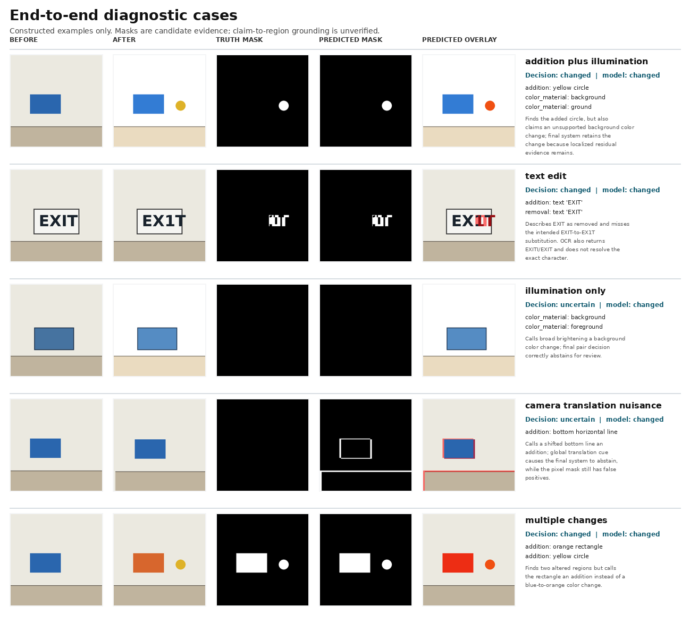

# Fine-Grained Image Difference Analysis

## End-to-End Diagnostic Submission Report

**Date:** 16 October 2026  
**Scope:** Independent implementation and controlled, synthetic evaluation  
**Status:** Research prototype; not a validated production system

## Executive summary

This work studies a practical question: given an ordered pair of images, can a system identify whether a meaningful change occurred, localize its pixels, describe the change in the correct direction, and distinguish scene changes from imaging nuisance?

An independent pipeline was designed and run on 11 constructed image pairs. It combines a transparent raw pixel-difference reference, a global photometric-residual view, connected-component regions, a camera-translation cue, cached Qwen3-VL 4B descriptions, and cached EasyOCR text cues. The system keeps these evidence sources separate and can abstain when the cues indicate nuisance or uncertainty.

On the constructed set, the raw RGB baseline achieved macro IoU 0.723 and micro IoU 0.148. The photometric-residual masks achieved macro IoU 0.905 and micro IoU 0.913. The gain was concentrated in global illumination cases; the residual mask still failed on camera translation (IoU 0.000, 6,536 false-positive pixels). Pair-level decisions covered 9 of 11 examples and were correct on those 9; the two camera/illumination nuisance cases were sent to review. Manual review of generated descriptions found 4 correct, 3 partially correct, and 4 incorrect claims. EasyOCR did not resolve the tested one-character text edit.

These measurements demonstrate behavior on controlled, constructed examples only. They do not establish performance on natural images or a public benchmark. The result supports the pipeline’s diagnostic design—especially preserving raw evidence while treating photometric compensation as a separate cue—but does not validate semantic descriptions, camera-motion handling, or deployment readiness.

## 1. Objective and evaluation requirements

Image difference analysis contains distinct tasks that should not be collapsed into one caption score:

1. **Change recognition:** decide whether a meaningful change exists.
2. **Localization:** identify the changed pixels or regions.
3. **Semantic direction:** describe what changed from the first image to the second.
4. **Nuisance handling:** distinguish object/property changes from illumination or viewpoint variation.
5. **Uncertainty:** request review when available evidence conflicts or is insufficient.

The required output preserves image order, reports spatial evidence independently from language, and does not treat a plausible caption or model confidence as proof. The dataset must include no-change cases and nuisance cases, and the evaluation must report pair decisions, masks, semantic review, and runtime separately.

## 2. Method and component rationale

### 2.1 Reference baseline

The **raw RGB pixel-difference baseline** compares aligned, equal-size images channel by channel, thresholds the per-pixel difference, and groups active pixels into connected regions. It uses no learned model and makes no semantic claims. This is the reference for quantifying how much broad appearance change contaminates a direct pixel mask. It is not a specialist image-difference model and is not presented as a state-of-the-art comparator.

### 2.2 End-to-end diagnostic system

| Component | Purpose and evidence limit |
|---|---|
| Raw RGB map | Retains the direct signal and supplies the reference baseline; sensitive to lighting and camera movement. |
| Photometric residual | Estimates broad channel-wise change and reduces illumination nuisance in the selected mask; may suppress genuine broad changes, so raw evidence remains available. |
| Connected components | Groups candidate pixels into reviewable regions; boxes do not establish object identity or change type. |
| Translation cue | Flags likely global shift for review; does not align images or remove all shift errors. |
| [Qwen3-VL 4B Instruct](https://huggingface.co/Qwen/Qwen3-VL-4B-Instruct) | Cached general VLM chosen for local availability and GPU fit; not a specialist, and claims lack region grounding and calibrated confidence. |
| EasyOCR | Cached text-specific cue; useful as a cross-check, but it missed the tested character edit. |
| Review policy | Keeps pair decisions separate from masks and captions and permits abstention; thresholds are not application-calibrated. |

### 2.3 Processing sequence

For each ordered pair, the system validates image readability and dimensions; computes and retains raw difference evidence; estimates the photometric residual; extracts connected regions; estimates a global translation cue without warping; optionally generates structured Qwen3-VL claims and EasyOCR text; then combines independent evidence into a changed, unchanged, or review decision. It writes pair JSON, masks, overlays, previews, and run metadata. Different image dimensions are rejected rather than silently resized.

## 3. Experimental protocol

The diagnostic set contains 11 constructed pairs: no change, small addition, reversed removal, color change, movement in both orders, a one-character text edit, illumination only, multiple changes, a genuine addition under illumination, and camera translation without semantic change. The six simple semantic-change pairs use masks from their rendered pixel changes; no-change and illumination-only use empty semantic masks. The three harder multiple-change/nuisance pairs use hand-authored masks that exclude nuisance-only regions. This setup gives controlled checks, but it is not a sample of natural-image variability.

Two localization runs used the same ordered pairs and masks:

- **Reference:** raw RGB difference with the configured threshold and connected components.
- **Photometric-residual system:** the same pipeline with the global photometric residual selected as the candidate mask, plus Qwen3-VL and EasyOCR for pair/semantic cues.

Pair-level results are reported with coverage and selective accuracy so abstentions are not counted as correct classifications. Mask results include macro IoU (mean of per-pair IoUs) and micro IoU (intersection and union aggregated over pixels). Semantic descriptions were manually reviewed by the researcher against the constructed labels; this was not an independent or blinded human study. Thirteen deterministic unit tests and run-artifact validation were also completed.

## 4. Results

### 4.1 Localization and pair decisions

| Measure | Raw RGB reference | Photometric-residual system |
|---|---:|---:|
| Constructed pairs | 11 | 11 |
| Macro mask IoU | 0.723 | 0.905 |
| Micro mask IoU | 0.148 | 0.913 |

The pair-decision layer in the photometric-residual run covered 9/11 pairs (81.8%). Among covered pairs, it recorded 8 true changed cases and 1 true no-change case, with no errors (9/9 selective accuracy). It abstained on illumination-only and camera-translation nuisance. The mask did not share that success on camera movement: it still contained 6,536 false-positive pixels.

On the illumination-only pair, IoU rose from 0.000 for raw RGB to 1.000 for the residual; for the genuine addition under illumination, it rose from 0.009 to 1.000. Camera-translation IoU remained 0.000 for both masks.

The localization difference is consistent with the purpose of the residual view on this constructed set: it removed broad illumination differences while retaining a local addition in the mixed addition-plus-illumination case. The camera-shift result shows that global translation estimation without image registration does not remove displaced edges. Because the scenes and transformations are controlled and simple, the IoU values should not be extrapolated to real photographs.

### 4.2 Semantic and text results

Researcher review of 11 Qwen3-VL descriptions rated 4 correct, 3 partially correct, and 4 incorrect. The main material errors were incorrect direction/description of movement, confusing a one-character text substitution with text removal, and labeling broad brightening as a semantic color change. The model also made unsupported claims alongside a correctly identified addition. All pairs remained marked for review.

EasyOCR returned `EXITI` before and `EXIT` after for the constructed `EXIT` → `EX1T` edit. It therefore did not resolve the intended character substitution. OCR is not a reliable exact-text verifier in this run.

### 4.3 Visualization evidence

The figure shows five constructed examples with the before/after images, reference mask, predicted mask, overlay, generated claims, and review notes. It emphasizes the main observed behaviors: nuisance-only illumination is escalated, the text edit remains unresolved, camera translation creates false-positive pixels, and simple changes can be localized in these rendered scenes.

{width=6.5in}

### 4.4 Runtime and validation

The run used an NVIDIA RTX 4000 Ada Generation GPU with 20 GB VRAM. Mean Qwen caption-generation latency was 4.91 seconds per pair; total run time was 68.8 seconds. Peak allocated GPU memory was 8.44 GiB. The 11-pair output manifest validated with no artifact errors; its two warnings correspond to the intended review/abstention cases. All 13 unit tests passed.

## 5. Interpretation

The controlled comparison supports one narrow observation: a global photometric-residual view can reduce false localization from global illumination changes when those changes are nuisance, while the raw map remains available for inspection. On this set, the residual raised macro IoU from 0.723 to 0.905 and micro IoU from 0.148 to 0.913. This is a diagnostic result for the implemented method and examples, not evidence of generalization.

The semantic component is not yet dependable for fine-grained claims: fewer than half of reviewed descriptions were fully correct, OCR missed the exact character edit, and region-to-claim grounding remains unverified. The camera-shift mask failure is also unresolved. The system’s useful behavior is therefore to expose separate evidence and flag uncertainty, not to produce autonomous final judgments.

## 6. Limitations and next step

No public benchmark, real-image held-out set, specialist checkpoint, independent human evaluation, statistical confidence interval, or calibrated uncertainty estimate was used. Constructed masks are simple and closely tied to the rendering process. The decision thresholds have not been tuned to an application’s error costs. The current translation cue does not register images; photometric compensation may suppress real broad changes; and Qwen3-VL claims are not spatially verified. M³Diff/OmniDiff was identified as the first specialist reproduction candidate but not run: its approximately 16.2 GB checkpoint and custom LLaVA-based loader have unverified fit on this 20 GB GPU, and evaluation data access/terms were not confirmed. The weights were not downloaded; Qwen3-VL is not a specialist benchmark substitute.

The next research step is to secure a legally usable natural-image dataset with ordered pairs, change labels, spatial masks, and text annotations. Then freeze the evaluation protocol and compare the raw reference, the photometric-residual system, and a reproducible specialist baseline on the same pairs. Report localization, pair decisions, semantic correctness, nuisance robustness, abstentions, and runtime separately. Only after that evaluation should the system’s thresholds or architecture be considered for an application.

## 7. Reproducibility record

- **Model:** `Qwen/Qwen3-VL-4B-Instruct`, cached revision `ebb281ec70b05090aa6165b016eac8ec08e71b17`; EasyOCR cached locally.
- **Execution:** shared Python environment; no duplicate environment, package install, network access, or model download during the run.
- **Input manifest:** [`qwen3vl_synthetic_diagnostic.json`](../data/manifests/qwen3vl_synthetic_diagnostic.json).
- **End-to-end output:** [`qwen3vl_end_to_end/`](../results/runs/qwen3vl_end_to_end/).
- **Raw baseline output:** [`raw_rgb_baseline_11pair/`](../results/runs/raw_rgb_baseline_11pair/).
- **Metrics:** [end-to-end](../results/metrics/qwen3vl_end_to_end_synthetic.json), [raw baseline](../results/metrics/raw_rgb_baseline_11pair.json), [manual claim review](../results/metrics/qwen3vl_end_to_end_manual_review.json).
- **Visualization:** [selected end-to-end diagnostic cases](../results/visualizations/end_to_end_failure_gallery.png).
- **Implementation and commands:** [workspace README](../README.md); environment and data constraints are detailed in [`limitations.md`](../research/limitations.md).

## References

- Liu et al. [OmniDiff: A Comprehensive Benchmark for Fine-grained Image Difference Captioning](https://openaccess.thecvf.com/content/ICCV2025/html/Liu_OmniDiff_A_Comprehensive_Benchmark_for_Fine-grained_Image_Difference_Captioning_ICCV_2025_paper.html), ICCV 2025; [official implementation](https://github.com/Yuan-Liu-01/M3Diff).
- Qwen Team. [Qwen3-VL-4B-Instruct model card](https://huggingface.co/Qwen/Qwen3-VL-4B-Instruct) and [Transformers documentation](https://huggingface.co/docs/transformers/model_doc/qwen3_vl).
